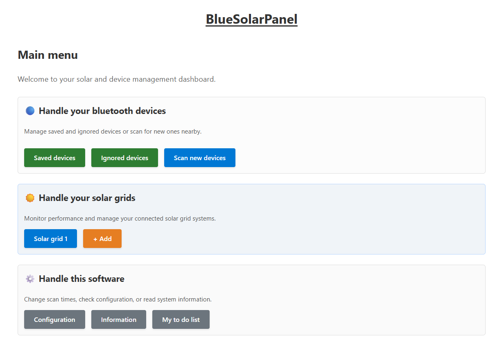

# BlueSolarPanel (Beta v0.1)

A lightweight Windows-based PHP and C# web dashboard for discovering, profiling, and reading raw Bluetooth Low Energy (BLE) GATT data from solar chargers, batteries (BMS), and off-grid equipment.

> **⚠️ Project Status: Beta / Work in Progress**  
> This project is published in an early beta state for the open-source community to explore, fork, and continue developing. Core BLE scanning, GATT raw data dumping, and driver matching work out of the box, while metric decoding and solar grid dashboards remain open for future contributions.



---

## ✨ Features

* **BLE Device Discovery:** Scans nearby Bluetooth Low Energy devices via a native Windows C# engine (`win64-blescan.exe`) with configurable scan durations (1–15 seconds).
* **Raw GATT Data Extraction:** Connects to saved or ignored devices (`win64-getdata.exe`) to dump available GATT Services, Characteristics, and raw hexadecimal payloads.
* **Extensible Driver Architecture:** Automatically identifies known hardware (such as **Daly/JBD Smart BMS** and **Victron SmartSolar**) using modular PHP driver files in `data/drivers/` and generates JSON device profiles.
* **Device Management:** Save trusted devices, assign custom aliases and operational notes, inspect raw hex responses, or ignore irrelevant hardware.

---

## 🛠️ Requirements

* **Operating System:** Windows 10 / Windows 11 (64-bit) with a working Bluetooth adapter.
* **Web Server:** PHP 8.0 or newer (e.g., XAMPP, Laragon, or built-in PHP server) with permission to run local `.exe` binaries via `exec()`.

---

## 🚀 Quick Start

1. Clone or download this repository into your web server's root directory (e.g., `C:\xampp\htdocs\BlueSolarPanel`).
2. Download **`win64-blescan.exe`** from the [**Releases**](../../releases) section on GitHub and place it inside `data/win64-blescan/` (or compile it yourself from `csharp-source/`).
3. Ensure Bluetooth is turned on in Windows.
4. Open `http://localhost/BlueSolarPanel/` in your browser.
5. Go to **Configuration** to adjust the scan duration if needed (default is `6` seconds).
6. Click **Scan new devices** to discover nearby BLE equipment and save it to inspect its raw GATT data.

---

## 🧩 Adding Custom Hardware Drivers

Drivers are stored as simple PHP files inside `data/drivers/` and return an associative array describing how to identify the device:

```php
<?php
return [
    'driver_id'     => 'my_custom_device',
    'category'      => 'solar_charger', // e.g., battery, solar_charger, inverter
    'device_name'   => 'Manufacturer Name',
    'fingerprint'   => '0000ff02-0000-1000-8000-00805f9b34fb', // Unique GATT UUID
    'name_contains' => 'DevicePrefix', // Fallback match on advertised/internal name
    'commands'      => [
        'Main Status' => 'DDA50300FFFD77'
    ]
];
```

When a new device is saved, `data/include/analyzer.php` automatically matches its raw GATT dump against all files in `data/drivers/` and creates a profile in `data/deviceprofiles/`.

---

## 📁 Project Structure

```text
BlueSolarPanel/
├── assets/                 # Dashboard screenshots
├── csharp-source/          # C# (.NET 8.0) source code for the BLE scanner
├── data/
│   ├── config/             # Scanner configuration (config.txt)
│   ├── css/                # Stylesheets
│   ├── devicedata/         # Raw GATT dumps per device (ignored by Git)
│   ├── devicelists/        # Saved & ignored device lists (ignored by Git)
│   ├── deviceprofiles/     # Generated JSON hardware profiles (ignored by Git)
│   ├── drivers/            # Modular hardware driver definitions
│   ├── include/            # Analyzer logic and shared layout includes
│   ├── tmpdata/            # Temporary scan cache (ignored by Git)
│   ├── win64-blescan/      # Folder for win64-blescan.exe (download from Releases)
│   └── win64-getdata/      # Compiled GATT raw data reader (.exe)
├── config.php              # Scanner settings UI
├── editdevice.php          # Custom alias and notes editor
├── ignoreddevices.php      # Manage, restore, or permanently delete ignored devices
├── index.php               # Main dashboard menu
├── information.php         # System documentation
├── newdevices.php          # Scan and save/ignore discovered BLE devices
├── readdevice.php          # Inspect raw GATT UUIDs and hex bytes
├── saveddevices.php        # Manage saved BLE devices
└── todo.php                # Roadmap and planned features
```

---

## 📄 License

Copyright (c) 2026 Björn Eriksson.  
Licensed under the **MIT License**.